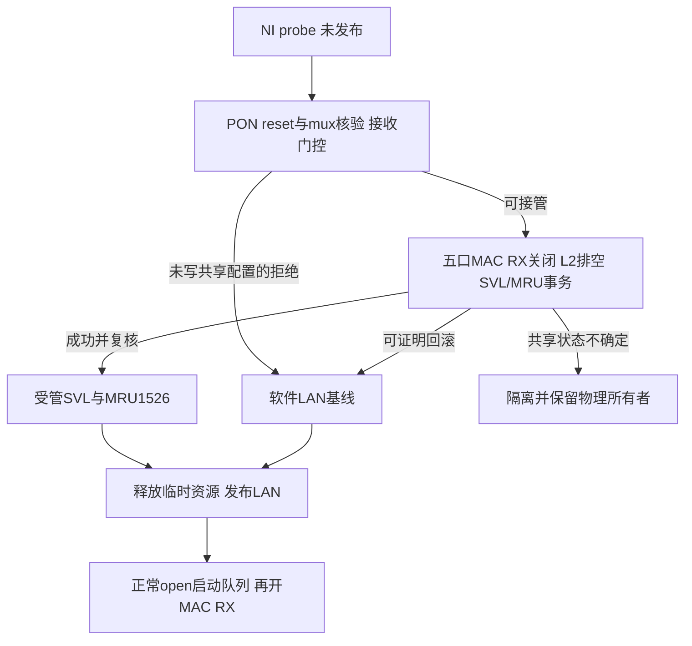

# RTL9617C SVL/MRU 冷交接整改

> 本文保留 2026-11-15 冷交接整改时的行为记录。后续 `native_l2` 默认请求已改为开启，但未放松本文的冷交接和失败隔离条件。当前配置与能力状态见 [硬件卸载支持范围](hardware-offload.md)。

日期：2026-11-15。远端审计基线：`99a3ec3b08eb675148b937d165594589d95fbad9`。

## 结论

本轮修复的是冷交接的所有权和启动顺序，不是继续关闭自动 SVL/MRU。两个生产 UBI 板型均选择本地冷初始化；NI 在自己的 probe 内完成可有界检查的冷事务，再发布 LAN。PON 的 GPIO、BOSA、IRQ 和完整驱动初始化不再控制 LAN 是否出现。

原生 L2 保持单独、默认关闭的用户请求。冷基线满足条件后，现有受支持 LAN bridge 可进入 native 准入，不再因为生产 DTS 永久跳过规范化而只能保留 IVL/9201。不可确认的共享写入仍隔离；陌生继承 FDB 不清空；不宣称源码验证等于板卡冷启动成功或线速验收。

## 一、确认的问题与修复

| 问题 | 旧代码后果 | 本轮处理 |
| --- | --- | --- |
| NI 成功 probe 但不发布 LAN，唯一发布者是后来的 PON helper | PON 的资源、GPIO、光学依赖或检查失败可使管理 LAN 永久缺失 | 移除 PON→NI cold 发布回调；NI probe 独立完成 bootstrap 和发布 |
| 撤掉旧 DT 属性恢复 LAN，但 FE 在首次 open 后已不允许冷修改 | 再开 L2 也无法补做 SVL/MRU | 新生产策略在任何 drvdata/netdev 发布前完成自动冷准备 |
| 无条件读写 EPON1G/10G/GPON/XG 四族 | GPON 模式下可能访问被 SDK 保持 reset 的 EPON block；普通 RAM mock 掩盖该问题 | 先读实际 mux/reset，仅访问 selected + released MAC；PDC held-reset 时零 MAC/FIFO 访问 |
| LAN 只改为 CPU16 bypass，未清 RXMAC.rx_en | 新包仍可能进入尚未启动的 CPU 队列，使冷排空前提不成立 | 保存并关闭全部五口 MAC RX、读回；不关闭 TX；由正常 ndo_open 在队列就绪后重开 |
| RX gate/stop-learning 的首次写被忽略也可能误判 poison | 可以证明旧状态未改变的失败也影响管理 LAN | 限定在尚未改变共享基线的阶段，核对精确原值（learning 还需两个命令窗口空闲）后归类安全拒绝；未知值仍 poison |
| 回滚前缺少再次局部排空 | 新出现的在途工作可能与回滚相交 | 共享写回滚前重新确认窗口空闲和 L2 排空；不能证明时不继续恢复/重新接管 |
| NI drvdata 出现后、注册批次拿到 RTNL 前就发布 provider_ready | PON 抢先 open 可持 RTNL 等待尚未排队/完成的 LAN4 barrier，NI 反向等 RTNL；四千兆板型也受影响 | 在持 RTNL、同步端口已注册且 LAN4 已排队或完成后，释放锁前发布 ready；更早的 open 返回可重试错误，不进入等待 |
| 已有测试把 FE、engine_start、四族 MMIO 都当作永远可用的 stub | 通过测试不代表正常 LAN 首次 open 或 cold→native 能成功 | 执行生产 helper、真实 fabric/FE adapter 与实际启动函数，保留必要硬件模型边界；补资源失败、并发、正向 native 准入及故障变体 |

没有新设备串口记录，不能把以上任一项单独宣称为 `v20261114-225843` 失联的已确认板上根因。

## 二、新启动路径与所有权

NI 的短期资源明确为：

| `reg-names` | 完整物理地址 | 长度 | 访问 |
| --- | --- | --- | --- |
| `pon-cold-mac` | `0x4f5500000` | `0xc000` | 仅选中 MAC 门控位及 PDC 状态 |
| `pon-cold-control` | `0x4f4320094` | 4 | GLOBAL_PON_CNTL 只读 |
| `pon-cold-epon` | `0x4f4320074` | 4 | GLOBAL_EPON_CNTL 只读 |
| `pon-cold-gpon` | `0x4f432007c` | 4 | GLOBAL_GPON_CNTL 只读 |

这些是 probe 内的 `request_mem_region`/`ioremap` 租约，不是与 PON 生命周期并存的两套 devm owner。每个失败出口和成功出口均释放所有已取得的映射及 region，之后才发布 NI drvdata。PON 正常 probe 在映射 MAC/global 寄存器前检查 NI drvdata，因而不会与这段临时所有权并行；其更早的 TX-disable GPIO 获取仍保留，属于独立资源，NI 不等待它。原来的反向 cold 调用已经删除；没有增加 NI→PON phandle 所造成的供应者环。

同一寄存器区间在两个 OF platform 节点中描述的可行性已对照锁定 Linux 6.18.60：`drivers/of/platform.c` 的 `of_device_alloc()` 只填充 resources，`of_device_add()` 走 `device_add()`，不走 `drivers/base/platform.c::platform_device_add()` 的资源插入循环。真正的 busy 租约在各自 probe 的 request 阶段取得，因此必须严格保持上述先释放、再允许 PON 接手的顺序。

正常 PON 初始化日后负责开启其 MAC。GPON `en` 与 XG `mac_en` 是 SDK 的 MAC admission 开关，并非可以承诺完全不影响协议 TX 时序的纯 RX 位。本轮不写激光 GPIO、全局 reset/mux、PSDS burst 或专用 TX 配置。

`cold_attempted` 禁止 warm open、错误重入或后续消费方再次进行冷写。资源映射失败、只读前置条件拒绝、PON fence 失败都不会变成“等待下一次 PON 回调”的无期限状态。

发布 drvdata 与允许数据面 open 是两个不同的边界。`provider_ready` 必须由 `rtl_register_lans()` 在 RTNL 保护的注册批次末尾设置；`rtl_engine_get()` 对所有板型均检查它。不能把 device link 当成替代：锁定内核允许 supplier 和 consumer 同在 probe 时创建 link，不会替此次并发初始化串行化。新增真实线程测试先让外部 PON 类消费者持 RTNL，再启动 NI 发布，覆盖四千兆和含 NI4 的两种板型；旧顺序会失败，恢复旧顺序的定向变体同样必须被拒绝。

## 三、SDK 依据与严格边界

采用原已锁定的厂商 GPL 公开镜像，不冒充 Realtek 官方支持的完整 NDA SDK，也不把其他芯片寄存器类推到 RTL77C。

- [ca-network-drivers 固定提交](https://github.com/jameywine/ca-network-drivers/tree/8b4f4882ff0e237a1fa558fb0838e4b680bd6bd0)：`aal-77c/aal_pon.c` 的 `aal_pon_mac_enable_set()` 按模式选择真实 MAC；`aal_psds.c` 的 GPON reset 路径会临时释放 EPON 以访问配置，随后重新保持 EPON reset。
- 同一固定版本 `aal_epon_mac.c` 的 PUC/PDC reset 序列表明：命名为 `pdc_reset` 的字段实际 **0=assert，1=release**，不能仅凭字段名字反推极性。
- `aal_xgpon.c::__glb_gpon_ctrl_init()` 对 GPON/XG 给出不同 child reset 配置；`aal_psds.c::__psds_eth_csr_reset()` 的 Active Ethernet 配置 `0x30200` 说明不能只检查 `epon_ethernet_mode`，还必须识别独立的 `act_eth_rst_n`。
- `aal_ni_l2.c::__ni_rx_init()` 和 `aal_port.c` 的端口停用顺序分别确认真正的 RXMAC 接收门控，以及 TX 应保持开启避免已有缓冲挂住。
- [GPL-for-GP3000 固定提交的真实寄存器头](https://github.com/jameywine/GPL-for-GP3000/blob/5090fbcb6ba743dd7b1314811ef557bad0460147/linux-5.10.x/include/soc/cortina/rtl8277c_registers.h)：验证三个 GLOBAL union、四类 MAC gate、PDC occupancy、五口 UNI rx_en 和 shared length 字段。输入 SHA256 在 oracle 中再次固定。
- [Linux switchdev 契约](https://docs.kernel.org/networking/switchdev.html)：native 开门仍受 Linux bridge 拓扑/FDB/STP 授权；不因冷基线就绪就越过控制面直接转发。

Active Ethernet 或父/子 reset 状态不一致时，当前 bootstrap 拒绝规范化、保留软件 LAN，而不猜测额外模式。PDC/L2 的稳定空仅证明本地检查条件，不证明整个 L3/DDR/AXI 在途事务已经退休。reset/mux 的选择也不能代替实机 APB、时钟和 reset 行为验证；软件轮询有界不意味着可以给失去响应的总线 MMIO 提供硬超时。

### 继承 FDB

IVL→SVL 前仍使用完整 all-valid SCAN。任何动态、静态或组播有效行都拒绝改键，不采用全局 flush。SDK 完整 owner 中存在清表后改模式的操作，不等于本局部 owner 有权删除可能被 PON/L3 引用的继承行。

新增 `fabric_inherited_fdb_present/index` 指明这类拒绝；内部留存第一行原始数据供后续有针对性的核证。普通状态和默认采集不输出该行的 MAC 内容。若实机仍因继承表非空拒绝，下一步应核对该行与 bootloader/PON 的归属，而不是停用扫描或假报 native 已启用。

### UNI MRU

保持既定 `1500 + Ethernet14 + VLAN8 + FCS4 = 1526` 包络；保留存储预算、TPID 和其他模式位。关闭五口 oversize override。它支持最多双 VLAN 的软件回退，不宣称与软件 bridge 的逐字节 MTU 检查完全相同，也不宣称任意深标签或巨帧硬件交换。

## 四、结果与诊断

`/sys/class/net/lan1/device/cold_bootstrap` 是**缓存的冷启动历史**，不会在读取时映射 PON、发命令或尝试修复：

- `requested=1 attempted=1 managed=1 result=0`：本次 cold SVL/MRU 事务与其外部门控复核成功；不是 live L2 hit 证明。
- `managed=0`：检查 `result`、PON `stage/error/refused_register/refused_value`，以及 `l2_state` 的原始 `fabric_error/refusal/poisoned`。FE 的返回值 1 表示已验证的安全拒绝，原始 errno 在 FE 状态中。
- `pon_snapshot_ready`、`pon_gated_mask` 只是冷期快照；PON 正常启动后允许再开 RX，不能把这些值解读成当前仍然关闭。
- `fabric_cold_rx_gated`、`fabric_inherited_fdb_present/index` 区分真正关闭过 UNI RX、共享模式冲突、继承 FDB 冲突。

`scripts/observe_tyfza1_datapath.sh` 默认被动采集新增冷期状态。真正 native active 仍看 `l2_state` 的 `l2_requested/l2_active/l2_hw_reason_name` 与 `lan_native_l2_mask`，并结合后续 LAN–LAN 负载与 CPU/端口证据判断。

## 五、验证范围

本轮验证分三层：生产 C 的宿主执行/故障变体，固定厂商源与 generated union 契约，锁定 OpenWrt/内核的实际 ARM64 对象与两个生产 DTB 编译。精确完成记录随本提交的 PR 检查和脚本 JSON 产物提供；未完成的层次不得用其他层通过替代。

新增测试必须接受真实 cold→SVL/MRU→正常 LAN open/native prepare 的正例，也必须拒绝恢复“等待 PON”、跳过自动 cold、访问 reset 家族、只改 bypass 不关 RX、吞 poison、warm 重写和泄漏 MMIO 租约等错误实现。原有 NI4 并发完成、生命周期、FE/bridge/policy/FDB、软件回退与硬件对象回归继续运行。

宿主执行仍有明确边界：冷交接、fabric/FE adapter、NI 生命周期及 native recipe 执行生产 C；集成用例中的完整 QM/DMA 硬件初始化与 FE resume 内部 MMIO 使用仪器化边界桩，分别由已有专门回归覆盖，不能据此宣称整个 ASIC 已联合验证。

本地最终定向回归记录：

| 检查 | 通过范围 |
| --- | --- |
| NI 冷交接联动 | 48 个场景；9 个定向错误实现全部被检测 |
| LAN 异步注册/外部抢先 open | 25 个真实线程场景；恢复早发布 ready 的错误实现被检测 |
| LAN 注册隔离 | 94 个场景，含 4 个 NI4/首次 open 真实锁交错 |
| NI 生命周期 | 143 个场景；6 个错误实现被检测 |
| PON 模式/reset/fence | 8,852 个场景；14 个错误实现被检测；固定 SDK/generated union 校验通过 |
| 冷 fabric | 475 个场景；17 个错误实现被检测；固定 SDK/generated union 校验通过 |
| Native 硬件 recipe | 7,762 个基础、1,776 个故障及 62 个 cold→native 准入/停用/恢复场景 |

测试数不是实机覆盖率；不同脚本存在重叠，不把它们相加作独立硬件验证数量。

### 实机验收尚未完成

本轮没有刷写设备、启动远端测速或改路由器配置。下一阶段需对候选固件记录：

1. 两种 LAN 板型的冷启动，含不接光纤、PON/BOSA 延迟和 PON 正常启动；四口/含 NI4 的管理连接正常，不能只证明网口注册。另测 LAN 持续输入且 PON 有继承待处理流量：当前先检查 PDC 排空，再进入 UNI gate，模型不能证明共享下游压力下这一前置检查一定成功；可确认的超时仍应保留软件 LAN 并记录拒绝。
2. 缓存 cold 结果与 live SVL/MRU 一致；普通 native 请求可以到达 `l2_active=1`，非空继承 FDB 等拒绝有明确原因。
3. LAN–LAN 双向/并发转发、CPU 收包变化、丢包与错误计数，以及 PON/PPPoE、VLAN/QinQ 软件回退不回归。
4. warm 接口开关、桥策略变化、PON 重连不会重写冷 SVL/MRU；若异常，保留串口和完整冷期诊断。

不在这些结果出现前宣称已保证任意硬件故障下 LAN 可用、所有原生 L2 流量已硬件卸载，或原约 400 Mbps 症状已消失。
