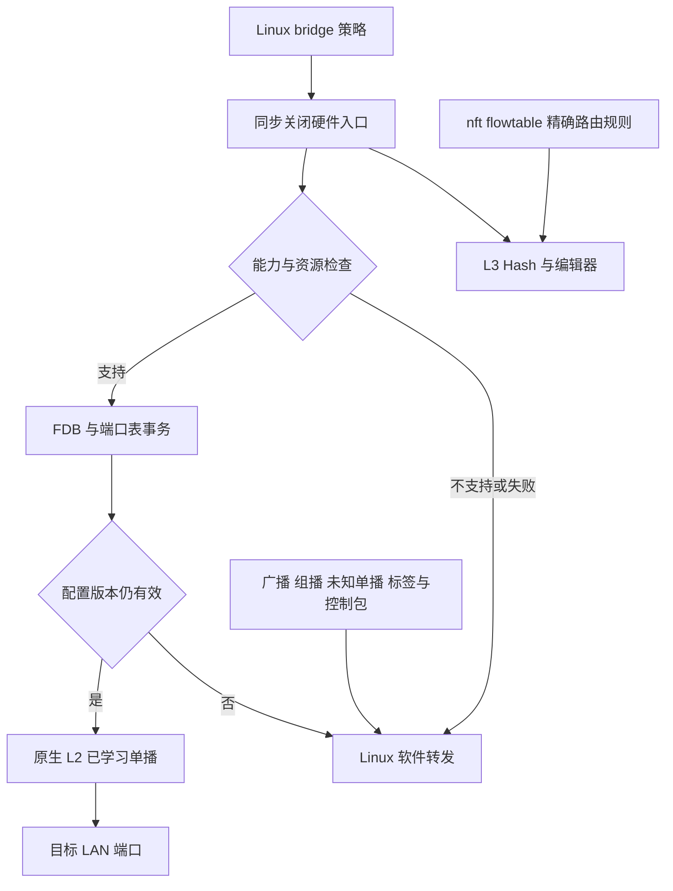

# RTL9617C 原生 LAN–LAN 交换：实现、证据与验收边界

日期：2026-11-14。初始实现基线：`00fc5a84e89d3c55c0b9d3d64affff64b82a789d`；本文随 PR 的后续审计修复更新，不能将初始基线视为已包含全部修复。

本轮重新核证的完整二层实施路径、精确 SDK 位置与真实缺口，见 [完整 L2 证据矩阵](rtl9617c-full-l2-evidence-20261114.md)。**不是 SDK 没有 BUM/VLAN 能力，而是当前实现尚未包含这些 owner 与 Linux 控制面。**

## 结论

本次增加 **Linux bridge/switchdev 授权的原生 L2 交换后端**，不恢复已经移除的“观察一个允许报文，再生成宽 MAC/EtherType 规则”的旧学习器。L2 与 WAN 的 nft flowtable 硬件路由是不同能力、不同开关，但共享一个资源所有者和同步策略闸门。

必须区分“LAN–LAN 功能完整可用”与“全部二层业务都在 ASIC 内完成”：

- 本次支持的硬件快路径是：**单个普通、未启用 VLAN filtering 的原生 LAN 网桥，已学习的无标签单播，在 LAN 端口之间由 L2 引擎直接交换**。
- 广播、未知单播、组播、链路控制以及带标签报文送 CPU，由 Linux bridge 保持其完整转发语义；它们不是硬件复制后再交 CPU 的双路径。
- VLAN-aware bridge、跨不同交换域的端口、多网桥、复杂端口策略等不具备可靠表示时，明确软件回退。不宣称已经完成所有 VLAN、MDB、BUM 的硬件卸载。
- 新 L2 后端在本版本**默认关闭，显式选择后才尝试启用**。没有实机验收前，不因升级固件自动改变用户的 LAN 数据面；该默认值独立于 WAN 硬件路由开关。
- 本轮源码、SDK 编码、故障模型和编译检查，不等于板卡开机、线速、时延或长期稳定性验收。尚未测出原先约 400 Mbps 症状的唯一根因或修复后的 Mbps。

## 数据面与控制面



原 LAN 接收基线是 bypass 到 CPU16，旧 L3 硬件模式只是把目标改为 L3 连接口25，不能据此声称使用了原生交换机。新后端在准备所有表项、学习域、异常 trap 后，才允许通过版本检查清除相应 LAN RX bypass 位。普通 CPU fallback 仍可转发，不通过关闭 MAC TX 来实现策略保护。

桥端口的硬件身份取自共享平台资源地址，不用可变 MAC 或内核指针。只用 notifier 观察控制面；生产 RX 回调不创建规则、不分配学习对象、不把“看见一个包”解释成授权。

## 能力矩阵

| 场景 | 本次处理 | 边界 |
| --- | --- | --- |
| 单个原生 LAN 网桥，无标签已学习单播 | 原生 L2 硬件交换 | 至少两个在线支持端口；在线成员须 forwarding、learning；未插线口不再使整个桥降级 |
| WAN 软件 flowtable，LAN 原生 L2 | 可分别选择 | L2 不要求开启 WAN HW；桥本机目的 MAC 留在 CPU |
| WAN 硬件路由与 LAN L2 共存 | 共享闸门、独立 FDB 域 | 路由仍须 nft 精确授权；本机 MAC 可导向 L3 连接口 |
| ARP、DHCP、IPv6 ND、广播、未知单播、组播 | CPU trap，Linux bridge 决策 | 不声称 BUM/MDB 硬件复制；不设置 `offload_fwd_mark` |
| IGMP/MLD snooping | Linux 保留 | 组播全部 trap，不为组播建立虚假的 HW offload 标记 |
| STP 变更、端口 down、桥成员变更 | 发布新策略前同步 gate，随后撤销重建；`GOING_DOWN` 先于 MAC stop 失效 | 在线非 forwarding 成员整体回退；离线成员排除，但其桥/VLAN/混合域策略仍检查 |
| VLAN filtering / PVID / tagged bridge | 软件回退 | 不运行中改全局 IVL/SVL，不清空外部 FDB |
| 端口隔离、hairpin、locked/MAB、复杂桥私有选项 | 软件回退 | 不丢弃 Linux 语义换取命中 |
| bridge netfilter、额外 ingress/egress hook、TC/XDP、显式整形 | 保守关闭硬件路径 | 预先存在的规则和后添加的规则均覆盖；不是只检查一个瞬时配置 |
| 桥管理者开启 promiscuous capture | 软件回退 | 抓包会改变路径，不能用它作为未扰动性能测量 |
| 多桥或混入非该 ASIC 的端口 | 软件回退 | 不冒认单一 hardware domain |
| 表满、外域冲突、间接窗口超时、未证明完成的恢复 | 关闭入口并保留所有权 | 不全局 flush、不释放仍可能被硬件使用的对象 |

## 资源正确性与性能关键点

### 1. L2 FDB 与 L3 DA 索引分离

L3 目的 MAC 改写引用同一个物理 FDB 的行索引。原 VID0/SC0 静态 pin 会与桥的动态学习、移动及老化直接冲突；简单加一把锁不能消除所有权冲突。

- 原生 L2 域：`MAC / VID0 / SC0 / PCP0`。
- L3 索引 pin：`MAC / VID4095 / SC1 / PCP0`，有效静态单播，防御性 LPID16。
- FDB 容量按 SDK 的 **4096 + 32 = 4128** 行检查，不把 13 位索引误当作 8192 行。
- L2 不删除 L3 域，L3 不借用桥的普通行；碰到同 key 的不兼容外部行拒绝安装。
- V1 只接受设备**已经处于 SVL 且 PCP 不参与 key**，不修改整个芯片的 VLAN 模式。原生域已有未知所有者或其他域存在动态条目时，不抢占或清表。

完整调用链、源文件哈希、SVL 包侧归一化与 raw CPU 命令区别见 [FDB 隔离证据](l2-fdb-domain-evidence-20261114.md)。这是公开厂商 GPL 源码支持的设计，不等于已获 Realtek 闭源微架构手册认证。

### 2. 不能只关 LAN：PON→L3 的原子闸门

只将五个 LAN RX 目标改回 CPU，阻止不了已经命中的 PON→L3→LAN 流。新实现为两侧共享的 L3 分类器准备两个 profile：

- profile0：保留真实 LSPID、允许精确 Hash 查询。
- profile1：SDK 的 `keep_orig_pkt`、`t2_ctrl=15`、permit、CPU16 动作，跳过 Hash 并保留原包。
- 原子回调只切换 LAN/PON LPB 的直接 MMIO selector，并读回；不在 spinlock 内写间接表、分配内存或睡眠。
- 四个默认 result group 使用相同动作，不假设它们互斥。每个 standard FIB 的**两行都初始化**，含第二行的格式字段。
- 先检查 256 个真实 TCAM key 行没有有效外部规则；否则不能声称 default action 一定执行，拒绝占用，不清除其他人的 ACL。
- 更早只读核对 PP parsing-error、over-VLAN、DDoS trap/drop 四类 override。它们可绕过 LPB；若不是保留原包的 CPU/drop、所有后续 route/edit stage bypass，则报告首个寄存器/原值并拒绝，不能仅靠 TCAM 为空判安全。
- 两个 LPB CPU selector 都须读回成功，准备失败不能对外报告启用成功。
- 只有配置版本一致、无持续 veto、引擎 ready、表准备成功时才重新开放；`fe_prepare()` 自身不能开门。

这一设计避免用 raw PDC bypass 处理 PPPoE 控制流，因为该路径不等价于保留原包的 CPU action。仍需实机核对 LCP、IPv6、异常包以及命中路径。

### 3. 学习、老化与 Linux FDB 一致性

硬件自己学习普通单播，软件按受控 SCAN 周期同步到 bridge，首轮采用 1 秒周期。扫描 filter 是共享全局资源，必须完整保存并安装“所有有效条目”过滤器，不能继承 bootloader 的窄 filter 后误判条目消失。

只有完整成功的扫描才能判定缺失；扫描失败关闭入口并保留已知状态。撤销域时先收集所有 key，再删除并完整复扫，不依赖删除不会挪动 overflow 行的未证明假设。

硬件反馈的“检查 epoch + 发布 FDB”与 CPU MAC move 在同一个锁序下原子化，避免慢扫描把 Linux 已更新的端口覆盖成旧端口。清理前检查当前 entry 仍属于相同 hardware-learn 所有者，不能误删后来由用户替换的静态、本机或 sticky entry。

全局 learning/aging 可能影响其他端口，因此非 LAN 学习必须隔离，外部动态条目必须拒绝；只在实际 arm 时改变本次老化设置。保留设备既有计时基准，不能把“非零 timebase”称为已经校准到 1 秒，实机仍须验证 aging 的实际周期。

### 4. 故障与共享窗口

所有表项写入都有原始快照和所有权。超时不表示命令没有执行；不能立即复用 DATA 或释放对象。FDB ACCESS 与 MAC-limit ACCESS 共用 command mode，操作前及恢复模式前同时检查两个窗口空闲。

停机、失效、重新打开分别保留明确状态；pending parser/PLE/PE/LF 以有界条件等待，不用固定 sleep 宣称所有包已离开 ASIC。同步 gate 的契约是**阻止新准入**，不是追溯撤回已经完成转发决策、排队在 MAC 的旧帧。

### 5. FE 基础配置与 NI 队列改为设备生命周期所有权

Linux 的最后一个 NI 用户关闭，不代表 PON 的 PDC 表已不再引用 connector24，也不代表旧包已离开 FE/QM。因此正常关闭接口不能恢复旧 CLS/LPB、重发所有 BID、清零 DMA ring 或释放 DDR。本轮采取明确的保留契约：

- 冷启动只建立一次 NI/QM/TX DMA 基础状态。正常 stop 关闭主机收发、IRQ/NAPI 和硬件路由准入，保留 EPP、refill、BID、deep-Q、TX 环及其游标；warm start 复用而不重新初始化。
- FE 成功安装的 CPU-original profile、connector mapping、DMA 基址及其分配保留到设备生命周期结束。正常 CPU/HW/OFF 模式切换不还原 foreign profile；warm start 先关闭入口、核验定义位与共享资源契约，再恢复请求的模式。
- 有效字段的核验不比较未定义保留位。CLS mode0 第一行按 SDK 的真实字段掩码，第二行只核验 format；LPB HI 只核验低 30 位。额外的独立 SDK oracle 编译真实结构体、generated union，并运行错误变体确认测试会失败。
- 只读 preflight 失败可以重试；已经发布地址或部分写入基础配置后失败，保留资源并隔离到重启。完整基础状态下暂态流/表清理失败可以在之后 open 重试，但不能借重试重建队列。
- PON queue gate 的期望掩码与实际启用分开；冷初始化、正常关闭及失败期间保持实际关闭，恢复操作不能越过 `host_active`/隔离状态重新开门。TQM reset 后及 ES/RMU 启用前再次明确关闭，不能假定复位保留此前写入的零值；首次默认掩码不覆盖已有的显式关闭请求。
- remove 路径先关闭软件调用、通知、work/timer、IRQ/NAPI 与 TX owner，再请求 FE 退出。没有完整 drain 证明时，保留暴露的 DMA 分配、provider 对象和物理地址范围 claim；同范围再次 probe 被拒绝，不能靠“泄漏旧内存后重开新设备”规避所有权。
- NI 驱动改为 built-in，并隐藏 sysfs bind/unbind，防止带未退出回调的模块被卸载；同时要求 `PHYLIB=y`，不能让 built-in NI 调用仅编译为模块的 PHY 库。板级原配置已经是 built-in；这不是对任意平台热拔插的支持承诺。
- 原始 `qm_wait`、`qm_es`、`qm_buffer` 控制改成只读诊断，避免绕过所有者在线改写队列契约。不能再依赖这些属性作运行期调参。

这消除了已定位的**停启交接、基础配置过早还原、队列重复初始化和整块 DMA 过早释放**路径。它不证明每个 action/Hash/DA/EIF/source-CAM/MTU 索引在逐流删除后均已完全退休；源码中继续公开 `full_l3_drain_verified=0`。完整 L3/AXI drain、逐流索引复用和实际板卡运行仍是独立验收项。

### 6. 性能观察不能只看开关

`l2_requested=1` 不表示硬件已启用，`enabled=1` 不表示每个包命中，conntrack 的 `[HW_OFFLOAD]` 也不是双向实时硬件状态。

策略变更撤销旧 L3 规则后，内核 HW 标记可能短时保留；实际软件 fastpath 刷新会重新请求安装，持续 veto 时拒绝，重新 arm 后可恢复。不能把 STATS 的 `-ENOENT` 描述为自动清除内核标记。

应同时查看：

- `l2_active`、`l2_reason`、`l2_error`、`l2_ports`、`l2_domain_owned`。
- `route_gate_ready`、`route_admitted`、`l2_flow_allowed`。
- `pp_rejected_register / pp_rejected_value`，区分未满足硬件前置契约与普通 flow 解析拒绝。
- FE 的 `base_ready / base_failed / base_lifetime_owner`、`base_rejected_register / base_rejected_value`；NI `xram_state` 的 `base_ready / dma_exposed / engine_poisoned / host_active / reboot_required`。FE 的隔离状态与 NI 的冷初始化失败状态分别检查。
- 实际读回的 `lan_cpu_mask / lan_route_mask / lan_native_l2_mask`。
- `l2_static / l2_learned / l2_polls / l2_scan_errors` 与 QM CPU 字节差分。

`l2_bum_hardware=0`、`l2_vlan_hardware=0` 刻意公开未实现能力，不把 software fallback 伪装成 ASIC 转发。

## 控制与回退

`l2_switch` 位于共享 NI 平台设备的 sysfs 属性，表示请求，不是强制改寄存器。运行时写入 `1` 尝试启用，写入 `0` 同步撤销；重启回到默认关闭。当前没有新增 LuCI/UCI 持久化选项，避免把尚未实机验收的功能当成稳定默认。

先在设备上只读定位属性，不假设不同板型的平台设备路径完全相同：

```sh
find /sys/devices -name l2_switch -type f
```

在有独立管理通道的维护测试中，对定位出的**确切单个路径**写入请求；不要批量写多个推测路径，不修改 raw `rx_bypass`。该原始 bypass 属性已改为只读，防止绕过资源准备和版本闸门。

`l2_reason` 对照：0 正常，1 未请求，2 引擎未 ready，3 无满足条件的桥，4 多桥，5 混合端口，6 VLAN 不支持，7 桥私有策略，8 端口策略，9 promiscuous，10 持续/并发策略保护，11 IO/恢复错误，12 外部 FDB 冲突，13 FDB 容量，14 硬件前置模式不支持。应结合 `l2_error`，不能只凭单个编号认定为故障。

不支持的硬件前置模式保持软件路径；外部动态 FDB 阻塞可有限退避重试，不无限高速轮询，不清空 PON/bootloader 条目。

## 测试与审计方法

代码入口：

```sh
sh scripts/check_firmware_prebuild.sh
bash scripts/check_sdk_contracts.sh
bash scripts/check_kernel_objects.sh --jobs 2
bash scripts/check_flowtable_contracts.sh artifacts/kernel-objects/linux-6.18.60
python3 scripts/test_l2_bridge_eligibility.py --kernel artifacts/kernel-objects/linux-6.18.60
```

测试不是只搜索关键字或用同一套位移公式自证：

1. 用锁定的厂商 generated register union、真实 SDK struct/converter 与生产 helper 对照字段、索引和命令；每个下载输入校验 SHA256。
2. 执行真实生产函数，注入 busy-before-DATA、命令超时、业务状态失败、部分恢复、错误 readback、外部行、错误索引、陈旧 FDB format 等反例。
3. 实际 core guard 在 pthread 双线程中执行 gate/arm/epoch 交错；执行真实 bridge FDB 发布和按所有者删除契约。主机模型不冒充完整内核并发或实机 MMIO 时序。
4. 部分关键测试对故意损坏的生产变体确认会失败，避免只验证“永远回退”也能 PASS。
5. 从校验过 SHA256 的 Linux 6.18.60 tar 与锁定 OpenWrt 补丁集完整准备树，所有补丁零 fuzz 应用；CI 编译真实 AArch64 leaf objects，并对 ELF 架构做检查。

对象编译不等于 vmlinux 最终链接、固件镜像、刷机或吞吐。最终运行证据以该提交 PR checks、`rtl9617c-l2-host-evidence` 和 `rtl9617c-kernel-object-evidence` 为准；不沿用旧提交的绿色结果冒充此次验证。

## 实机验收矩阵

测试端必须是交换机两侧的两台外部有线主机；路由器本机 iperf 测的是 host RX/TX，不是 LAN–LAN 硬件交换。记录确切固件 commit、芯片/机型、端口映射、协商速率、MTU、同一服务端和新旧流条件。

| 测试 | 必须观察的结果 |
| --- | --- |
| 软件 LAN bridge → 请求原生 L2 → 软件，交替三轮 | 实际 RX mask 改变；已学习单播 CPU punt 显著下降；吞吐不因开启回退 |
| 单流、多流、双向、64/512/1518 字节，各端口组合 | 区分包率与线速；1G/2.5G 按实际端口分别验收，不承诺超物理瓶颈 |
| ARP/DHCP/IPv6 ND/组播/未知单播 | Linux 正常处理；无重复包、无跨桥泄漏、不误打 offload_fwd_mark |
| MAC 从 LAN A 移到 LAN B，与硬件扫描并发 | 不把 Linux 新位置覆盖回旧口；无持续黑洞 |
| FDB 老化、本机 MAC、用户静态/sticky 变更与删除 | 动态行消失与重学正确，用户替换条目不被旧清理误删 |
| STP forwarding→blocking、端口 down、VLAN filtering、显式 TC、bridge netfilter/XDP | 新策略发布前关闭新准入，已命中 LAN 和 PON 双向路径都失效；CPU语义保留 |
| WAN SW + LAN L2；WAN HW + LAN L2 | 不由 WAN 开关错误控制 LAN；L3 DA pin 与 L2 同 MAC 行同时存在且无互相恢复 |
| PPPoE 数据/LCP 与策略变更同时进行 | 控制帧保持原包，不因 T2 bypass 错重建为 PPP IPv4 |
| NI 最后用户关闭再开、PON 重拨、重复切换、失败重试 | 同一有效 CPU profile 与队列复用；无重复 MEM_INI/BID 投递、无 ring 游标重置；部分失败隔离而非重新分配；不覆盖 busy 命令 |
| 长时间流量、连接 churn、接近 FDB 容量 | 无其他域被回收、无高频失败重建、CPU与内存稳定 |

没有独立管理通道与恢复方案时，不在唯一 SSH 链路自动执行 down/up、故障注入、固件升级或重启。本轮只提交代码与检查，不自动改用户路由器。

## 后续“全二层硬件化”的未闭合项

要把所有支持的 LAN–LAN 流量进一步留在 ASIC，还需要独立完成：

1. **BUM/MDB 硬件复制**：已有 MCE/MCFIB/按入口 DFT、`keep_o_lspid`、POL_ID token 的确切 SDK 基础。还须实现独占资源、CPU copy 的原始 ingress 与 generation、Linux 去重；不是因为缺少专用“已转发位”就不能做。厂商默认 SA FDB 反查不能直接保证首次学习/MAC move 的正确来源。精确 MDB/SSM 需要 IP/源匹配 owner，不能把 MAC FDB 等同于全部 Linux 组播语义。
2. **VLAN-aware 多域**：每 VID 的 membership、PVID、untagged/tagged、TPID、STP、private L3 pin 隔离，以及不影响 PON 的 domain ownership。不能通过全局 IVL/SVL 切换或全表 flush 草率实现。
3. **完整退休契约与实测**：局部 L2 pending、cache command 完成、固定延时均不等于完整 L3/DDR/AXI 排空；保留大块 DDR 也不等于 action/DA/EIF/source-CAM/MTU 行索引已可安全复用。需要芯片文档、受控 reset 完成契约或相应实机证据；另验 FDB aging、原包 trap、所有 LAN port/PHY 组合。
4. **硬件验收后才考虑稳定默认与持久 UI**：默认启用必须基于上述正确性与吞吐证据，不以 host test 数量替代。

## 主要资料

- Linux 官方 [switchdev](https://docs.kernel.org/networking/switchdev.html)、[bridge](https://docs.kernel.org/networking/bridge.html)、[flowtable](https://docs.kernel.org/networking/nf_flowtable.html)，以及锁定的 6.18.60 实际实现。
- `ca-network-drivers @ 8b4f4882ff0e237a1fa558fb0838e4b680bd6bd0` 的 `aal-77c`，包括 `aal_fdb.c`、`aal_port.c`、`aal_l2_vlan.c`、`aal_l3_cls.c`、`ca_aal_proc.c`、`aal_ni.c`。
- `GPL-for-GP3000 @ 5090fbcb6ba743dd7b1314811ef557bad0460147` 的 RTL8277C generated register header 与真实 77C FC/DAL 调用链。
- [此前路由卸载整改](rtl9617c-offload-remediation-20261113.md)是历史基线；其中“尚未实现原生 L2”的描述由本次的**明确能力范围**更新，不代表未实现的 BUM/VLAN 硬件能力也已完成。
