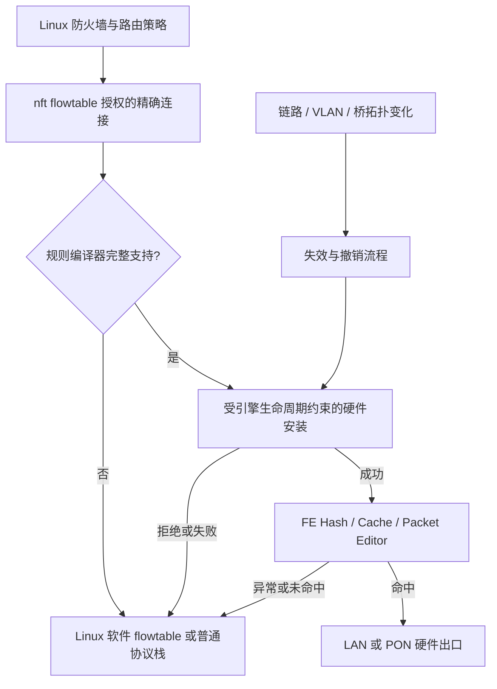

# RTL9617C 硬件卸载深度审计与整改

日期：2026-11-13。基线：`82881645fdd0063c8be18d05768476455d02f8d2`。

## 结论与交付边界

本轮重构的是**卸载授权、资源所有权、引擎生命周期、故障恢复和验证机制**，不是重写整个 OpenWrt，也不是未经证据替换全部 SDK 编解码。

代码中已经确认数类会导致策略扩大、假启用、未完成硬件事务被覆盖、错误恢复及 DMA 所有权破坏的问题，修复随本报告提交。**尚未在用户板卡上证明约 400 Mbps 的唯一根因，也没有测得整改后的吞吐数字。** 不把模型 PASS、`enabled=1`、`[HW_OFFLOAD]` 或规则安装数当作硬件线速证据。

保留基线已合入的 PR #15/#16，包括 collision guard、source/EIF ownership、PON CPU 路径和 NAND 错误传播；没有把这些已有修复重复计算为本轮新增。

## 整改后的架构



规则授权只有 Linux 一个来源。删除自主 L2 学习；不再开放无法完整实现优先级、链和策略变更语义的任意 `TC_SETUP_BLOCK`，只接收 `TC_SETUP_FT`。保留精确规则编译与安全软件回退，不用忽略匹配条件换取命中率。

引擎状态分为 `requested_mode`（0 OFF、1 CPU、2 HARDWARE）、`engine_ready` 和实际 `enabled/cpu_path/prepared`：

- NI 停止或重建前，必须先撤销旧 FE 状态；失败保留资源与快照，下一次启动不能覆盖它们。
- NI/QM/DMA 建立新 CPU 基线之后，重新建立 FE 快照并恢复已成功提交的模式；成功后才开放 NAPI。
- OFF/CPU/HARDWARE 请求只有在转换成功后更新意图；失败不能在下次重启时悄悄改变模式。
- teardown 先禁止回调与后台重排；无法证明撤销完成或仍有 callback 时隔离并保留 DMA/私有对象，记录需要重启，避免释放仍可能被硬件引用的内存。

## 逐项审计与实施

下列优先级表示整改顺序，不是经过 CVSS 计算的漏洞分数。代码位置均位于 `port/overlay/target/linux/rtl9617c/`，除非另行标注。

| 编号 | 优先级 | 已确认问题与触发条件 | 已实施整改 | 与性能症状的关系 |
|---|---|---|---|---|
| A01 | P0 | 一次允许的报文触发自主 MAC/EtherType 学习，生成不含原 L3/L4 策略的宽规则 | 删除生产 bridge learner 的 hooks、worker、队列及 RX skb extension 分配；只保留显式 flowtable | 安全边界错误；后台学习和 fallback 开销随之移除，不承诺量化增速 |
| A02 | P1 | NI 重启把 LAN selector 改回 CPU，FE 旧 `enabled` 仍为真，后续 enable 提前返回 | 新增 suspend/resume 与 requested/actual 状态分离 | **最直接的“显示开启但入口绕过 FE”候选**，需现场验证是否触发 |
| A03 | P1 | 多个间接表在上次超时后先覆盖 DATA，再检查 ACCESS | FE、QM、DeepQ、PON PDC/PVT/VSTBL/CIR/PIR 等在 staging 前检查各自 busy 位 | 可能造成规则、队列或恢复错误；无证据为固定 400 Mbps 限速 |
| A04 | P1 | FDB APPEND 可能已生效但超时，原 ownership 建立太晚；恢复只检查传输完成不检查业务状态 | 发命令前保留原行/键；LOOKUP、APPEND、DELETE 分别检查 SDK status；失败保留 owner | 避免假安装成功、未恢复资源与后续异常 |
| A05 | P1 | 未 ready 的共享 source/FDB 项可能继续被复用 | ready/deleting 明确约束，共享失败返回错误；最后 owner 成功恢复才释放 | 防止一次超时扩散到更多连接 |
| A06 | P1 | parser 静默忽略未知 key、部分 META/CONTROL/VLAN/TCP 匹配或不完整动作 | key 白名单、精确 ingress/family、VLAN 内层协议拒绝、TCP flags 子集、完整 MAC 改写、单个末尾 redirect、CSUM/L4 类型校验 | 能力不足明确软件回退，拒绝原因可见；不虚增硬件成功率 |
| A07 | P1 | bridge FDB 仍稳定时 STP/VLAN/PVID/TPID 策略改变，旧 flow 不一定失效；路径动作和后取 cookie 还存在错配竞态 | patch 219 增加 RCU 策略校验、cookie 及同快照动作核对，补 MAC/topology/port ownership 失效 | 修复稳定态错误转发；硬件删除仍是正常异步机制 |
| A08 | P1 | EPP 24-bit 指针范围/对齐未校验；payload 地址只检查总池，不检查 descriptor 所属 EQ | sync/读包前检查 1 KiB ring 和 8-byte 对齐；验证 EQ4/5 独立 buffer 分区，异常 VOQ 不阻塞健康 VOQ | 防止错误 DMA 访问、重复消费和跨池归还 |
| A09 | P1 | 清理失败仍可能释放硬件 DMA；退休 endpoint 的诊断可访问已释放 netdev；关闭后回调仍可能操作 MMIO | shutdown/retired guards、禁止重排、quarantine、保留 UNBIND 软件释放路径 | 故障隔离与稳定性；quarantine 明确是保留内存而非完整硬件 reset |
| A10 | P2 | 路由 mask 忽略 IPv6 独立扩展头及 L4 checksum-zero flags | 扩展头和零校验和保守回 Linux；显式打开 IPv4/L4 checksum engines | 能力收缩以保证异常边界；合法 IPv4 UDP checksum 0 也会回退 |
| A11 | P2 | QM AXI attribute 仅写 DATA0，未确定共享 DATA1 的高地址位 | idle 后显式清 DATA1，固定 CCI alias 编码 | 初始化确定性修复，未证实现场曾有脏 DATA1 |
| A12 | P2 | PON 分阶段切换失败未更新 `pdc_error`，读回可显示无错误 | 保存具体错误；保留已提交模式、映射和 owner，完整 mapped transition 成功才清错 | 避免误判模式/映射已全部切换；不是全表原子回滚 |
| A13 | P2 | `-EOPNOTSUPP` 等拒绝不可见；错误诊断路径、缺命令中止、缺固件身份 | 新增 admission/install 分类、QM CPU 流量计数、只读双快照采集器和 build-info | 使下一轮能够分辨安装失败、单向卸载、CPU punt 和队列问题 |

主要实现文件：`rtl9617c-fe.c`、`rtl9617c-fe-{bridge,format,pipeline,table,observe}.h`、`rtl9617c-xram.c`、`rtl9617c-qm.{c,h}`、`rtl9617c-qm-deepq.h`、`rtl9617c-pon-{pdc,path,puc}.c`、PON 表辅助头、patch 219。

### 兼容性与有意收紧的能力

- **纯 LAN–LAN 自主 L2 硬件学习退出。** Linux bridge 正常保留；这不是新实现了 switchdev，也不承诺纯二层桥线速。
- IPv4/IPv6 TCP/UDP、支持的 VLAN/QinQ、PPPoE 精确规则保留。复杂 EVTO、双侧 NAT/hairpin、未知 key、显式 priority 等不能精确表示时必须回退，不能丢弃语义。
- 新安装默认软件卸载开启、硬件卸载关闭。已存在的管理员 HW 开关不被覆盖；硬件功能仍可明确选择。此策略不是宣称“关闭硬件即修好了 400 Mbps”。
- 原 `observe_wired_offload.sh` 只作为兼容 wrapper，必须与主脚本同目录；单文件复制请使用 `observe_tyfza1_datapath.sh`。

## 三轮以上审计如何闭环

1. **源码与证据复核**：锁定最新 main，重读 FE/NI、QM/DMA、PON、Linux flowtable、fw4/netifd，排除已经修好的旧问题与无依据的性能推断。
2. **独立 SDK 对照与故障模型**：直接编译外部实际 SDK 结构、converter、CRC 和 generated unions；针对 busy、timeout、业务失败、partial transition 构造反例，尽量以旧提交验证测试确实会失败。
3. **实现交叉复审**：不同审查者复查其他分区，追加 FDB 业务状态、VLAN 内层协议、CSUM/L4 动作、关机 callback、旧 VLAN 动作/新 cookie、模式意图失败提交等修正。
4. **完整基线与编译复核**：官方 tar SHA256、全部 OpenWrt generic/ThorOS target 补丁零 fuzz 应用；在完整准备树重跑 9 项 flowtable host contracts；CI 实际编译 ARM64 对象并验 ELF 架构，不以 mock 或 prepare 代替编译。

## 验证入口与已获得的证据

```sh
sh scripts/check_firmware_prebuild.sh
bash scripts/check_sdk_contracts.sh
bash scripts/check_kernel_objects.sh --jobs 2
bash scripts/check_flowtable_contracts.sh artifacts/kernel-objects/linux-6.18.60
```

`check_kernel_objects.sh` 只编译对象，不生成/发布固件，也不访问设备。详细依赖见 `--help`；支持已下载 tar 和锁定 OpenWrt checkout。`--prepare-only` 明确输出 `compiled=0`。

本轮本地证据：

- 扩充的 prebuild gate 通过；包括生产函数提取执行、故障注入、observer 隐私/超时、构建身份测试。
- SDK 对照：67 action fields × 32 单位向量 + 512 随机向量；33 key fields × 32；1024 L3 + 256 L2 keys；CRC16/32、异常 mask、TCP flags 通过。
- 寄存器对照：12 类 ACCESS、8192 个 cache invalidate 编码、DDR/cache/AXI、EIF/MIB、PDC 256 slots、PVT/VSTBL/CIR/PIR、16-port/128-VOQ QM 参数通过。
- parser：1028 NAT/IPv6、288 VLAN/QinQ、8 PPPoE、24 显式 bridge 向量；20 个扩大规则反例、8 个 TCP mask、正常 checksum actions 通过。
- lifecycle：20 个 NI/FE 模式/故障组合、100 个 RX stop 交错、2000 个 flowtable 工作队列生命周期循环通过。
- 索引：16384 flows；退休端口、wrong-port、关机携带 retry 回调均验证。
- QM：226 个 ring/pool 边界与故障向量、126 个 cached-EPP 向量、729 个 refill/credit 向量、17 个表窗口通过。
- bridge：72 组有效 VLAN 路径及旧动作/新 cookie 竞态反例通过，防止只会拒绝所有规则的“修复”。
- 官方 Linux 6.18.60 tar 核 SHA256；233 backport + 271 pending + 69 hack + 25 target = **598 个补丁**零 fuzz 应用通过。刷新 190、216 的旧上下文，未修改其既有语义。
- 同一完整准备树上的 9 项 flowtable contracts 通过；实际 UCI 配置及真实 netifd callback/fork/exec 测试通过。

本地受 ptrace 限制使用 `ASAN_OPTIONS=detect_leaks=0`；ASan/UBSan 仍启用，不声称完成 LSan。SDK 仅对未改动 vendor `reverse_n()` 的 signed-shift UBSan 项局部豁免；不能由此声称整个 SDK 无 UB。

真实 ARM64 编译已经在首次远端 CI 的 [编译记录](https://github.com/AldenClark/ThorOS/actions/runs/43456507721) 中通过：60 个 leaf objects 的实际 AArch64 ELF、最终配置与 SHA256 均检查成功。该轮后续 host contracts 发现独立干净 job 缺少日志目录；测试入口已补目录初始化并重新验证。后续提交的最终状态以 PR checks 和 `rtl9617c-kernel-object-evidence` 为准。**对象编译不等于最终 vmlinux 链接、完整固件构建、开机或吞吐验收**。

## 不能继续沿用的推断

| 推断 | 核对后的结论 |
|---|---|
| 所有包先经过 FE，因此架构一定低效 | FE 分类是 SDK 正常路径；关键是命中后是否留在硬件，以及 miss/punt 的比例 |
| RX 有 memcpy，所以硬件快路径每包都复制 | memcpy 位于 CPU fallback 路径；真正命中包不应经过它。先量化 punt，再决定零拷贝是否值得 |
| 32 个 EIF/计数槽等于只能卸载 32 条连接 | 错。EIF recipe 可共享，未独占计数的流使用 age 活跃信息；当前驱动只选择 EIF0–31，物理 MIB 地址宽度另为 6 bits |
| DDR 发布次序、48-byte action stride 必定错误 | 已与实际 SDK/寄存器核对，不做无依据改写；软件一致性仍不等于所有时序已获芯片认证 |
| `[HW_OFFLOAD]` 表示双向加速成功 | 错。锁定 Linux 实际函数测试确认任一方向成功即可设置此状态，且状态不证明 ASIC 命中 |
| 硬件规则拒绝会让软件 flowtable 自动消失 | 未发现；实际上游函数测试保留软件 OFFLOAD 状态。仍需比较硬件模式下 miss/CPU 路径成本 |
| 已找到 QM/PON 固定 400 Mbps 限速 | 没有。当前 bitfield/policer/threshold 核对不支持这一断言 |

## 实机性能与正确性验收方案

### 测试拓扑与变量控制

测试端必须位于路由器两侧，**不要把路由器本机运行 iperf 当作硬件转发测试**。先在可控有线 LAN/WAN 拓扑验证，再进入真实 PON/PPPoE 线路。相同固件、端口、MTU、服务端、线缆、包长、连接数与测试时长；每组预热后测量，交替 SW→HW→SW 并至少重复三轮。每次切换后使用新连接，避免旧连接状态混淆。

不得在唯一管理链路上无保护地自动 down/up、刷机或注入故障；需独立管理通道与明确维护窗口。当前 PR 不执行这些动作。

| 组别 | 必测内容 | 主要目的 |
|---|---|---|
| 基础转发 | IPv4 NAT / IPv6 routing；上行、下行、双向；TCP 单流和多流、UDP 固定速率 | 分辨单向硬件失败、包率瓶颈和纯带宽限制 |
| 封装 | IPoE、PPPoE、单 VLAN、支持的 QinQ、实际业务 GEM/TCONT | 定位 EVTO/PPP/MTU/映射拒绝，不能混用不同业务对比 |
| 异常正确性 | SYN/FIN/RST、分片、IPv6 扩展头、TTL/hop-limit、MTU；零/错误 checksum | 验证应该进入 CPU 的包确实进入 CPU，NAT 后线上 checksum 正确 |
| 生命周期 | 多次 interface reload、最后用户关闭再开、PPP 重拨、VLAN/PVID/端口变化 | 确认没有旧 enabled、旧快照、旧动作、泄漏或未撤规则 |
| 扩展与持续运行 | 1/8/32/256 流、连接 churn、慢读/双向满载，长时间重复启停 | 区分安装/撤销控制面成本和已命中稳态吞吐，检查 age/counter 共享 |

对于协商 1 Gb/s 的链路，可把大包 TCP 接近正常千兆有效吞吐作为目标，但不把某个固定 Mbps 数字当所有 MTU、封装和线路的强制标准。更重要的验收是：HW 同条件不低于 SW 超过测试噪声、CPU punt 明显下降、双向数据符合规则且无异常重传/丢包/重置。

### 采集与判定

在明确授权的 A/B 测试期间执行只读采集：

```sh
sh observe_tyfza1_datapath.sh 15 > /tmp/datapath-software.txt
# 模式由独立测试流程改变，脚本本身不修改模式。
sh observe_tyfza1_datapath.sh 15 > /tmp/datapath-hardware.txt
```

记录 `/etc/thoros-build-info`、真实 UCI/nft 配置、FE state/rejection、每方向可用 MIB/age、QM `cpu_packets/cpu_bytes`、DMA/softirq/softnet、接口 errors/drops 与外部发送/接收量。采集器不读取凭据、完整 conntrack 或 PON 身份；默认 flow 行不带 IP/MAC/端口/session。`--details` 才显式包含敏感流元数据。

`cpu_bytes` 是 CPU-ingress 有效 L2 字节，包含后续 skb 分配失败，不是 ASIC 总流量。MIB 是原始累计值，只能在 flow/slot 未复用的同生命周期内做方向差分；共享 EIF 时不能把第 33 条以后缺少独占 byte counter 误判为没有卸载。`age > 1` 仅是活动证据，不是完整命中率。

判定顺序：

1. `enabled=0`、`engine_ready=0` 或错误非零：先解决状态/恢复，不做吞吐结论。
2. 安装失败或 `reject_pon/reject_vlan` 增长：先定位规则能力及映射，不盲目调 ring/AXI。
3. 只有一方向安装/计数增长：按该方向排查，不能依据 conntrack 总标志宣布成功。
4. 规则存在但 CPU byte rate 接近全部业务流量：重点查硬件 key、入口、cache、异常 punt；这才进入针对性硬件路径分析。
5. CPU punt 已很低但仍慢：查出口计数、PON DBA/TCONT、pause/backpressure、PHY错误、丢包重传、业务服务器和线路限制。
6. 只有 churn 时下降：测规则安装/撤销及 EVTO 编译延迟，和稳态转发分开优化。

## 尚未闭环的边界与后续准入

| 边界 | 当前状态 | 下一步与准入条件 |
|---|---|---|
| 用户所见 400 Mbps 的唯一因果链 | 未实测 | 上述同条件 A/B、双向 MIB/CPU量与外部吞吐关联后再定根因 |
| 全部 on-wire checksum、silicon timeout/drain 时序 | 公开 SDK 不足以认证 | 真实板卡抓包/故障测试；必要时取得准确芯片版本的 Realtek 编程手册与勘误 |
| FDB/SWO timeout 后控制位恢复时序 | 保留恢复责任，但没有完整硬件时序证明 | legacy live register/SWO 工具不得与生产 FE 并行；不得把窗口 guard 描述成完整事务认证 |
| bridge/STP 变化同步阻断 ASIC | 正常异步 GC/撤销，不是同步屏障 | 若要求零窗口策略变更，应单独设计硬件入口冻结/同步撤销并实测；不能在原子 notifier 中直接执行睡眠清理 |
| DIRECT 路由/ARP/NDP 下一跳变化 | 本轮 bridge/local MAC/topology 失效不等于完整 route/neighbour generation | 独立保留 route/neighbour lifetime或generation、异步撤销设计和运行期测试；不能声称已全面覆盖 |
| 私有 PPP channel 断开但无 netdev 事件 | 常规 pppd/netifd 生命周期覆盖，不保证任意私有控制方式 | 增加 channel/session generation 方案前先重现明确场景 |
| 真正 L2 硬件交换 | 不再使用不安全学习器 | 若确需，应独立按 switchdev/FDB/VLAN/STP/bridge policy 契约实现，不能重新打开旧 learner |
| 大量连接的控制面成本 | 仍有 FDB owner 列表查找及复杂 EVTO 判定，未测得其稳态影响 | 对安装/撤销做 profile；证实后再做资源索引和预编译 EVTO recipe，不用放松语义换速度 |

以上是已知边界而非“未来一定没有其他 bug”的承诺。硬件模式从实验功能进入默认生产功能，需要编译门禁、正确性负向测试、生命周期和实机性能四层全部通过。

## 资料与证据等级

- Linux 官方：[flowtable](https://docs.kernel.org/networking/nf_flowtable.html)、[switchdev](https://docs.kernel.org/networking/switchdev.html)、[DMA API](https://docs.kernel.org/core-api/dma-api-howto.html)。以锁定 6.18.60 实际源码解决文档与实现细节差异。
- Realtek 官方公开产品介绍仅确认 RTL9617C 的 offload 能力，不提供本驱动性能担保：[官方介绍](https://www.realtek.com/Article/NewsDetail?app_id=18&id=4309)。
- ITU-T [G.988 OMCI](https://www.itu.int/epublications/ar/publication/itu-t-g-988-2022-11-onu-management-and-control-interface-omci-specification/en)：用于约束 EVTO/GEM 业务语义，不作为 FE 位域文档。
- 固定 SDK、generated header、文件 SHA256、实际 oracle 和限制见 [SDK 对照记录](rtl9617c-sdk-contracts-20261113.md)。它们是公开 vendor GPL 镜像，不是已取得 Realtek 闭源手册或官方认证。
